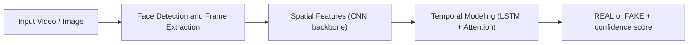

# Deepfake Detection System

A deep learning-based computer vision system that classifies images and videos as **REAL** or **FAKE**, with a confidence score. It was developed as a college minor project to address authenticity and privacy concerns around synthetic media generated by GANs and diffusion models.

The trained hybrid model is served through a Streamlit web app, so anyone can upload a file and get a prediction in the browser.

## Overview

The system works in four stages:

1. **Preprocessing:** frames are sampled from video, faces are detected and cropped to 224 x 224 tensors, then normalized.
2. **Spatial feature extraction:** a CNN backbone picks up pixel-level artifacts, blending boundaries and warping around the face.
3. **Temporal modeling:** LSTM layers with attention track unnatural blinking, irregular motion and frame-to-frame inconsistencies.
4. **Classification:** a binary REAL / FAKE prediction with a confidence score.



## Results

Trained and evaluated on the Celeb-DF dataset.

| Model | Type | Accuracy |
| :--- | :--- | :---: |
| XceptionNet | Frame-level CNN | 92% (top-1) |
| Hybrid CNN-LSTM-Attention | Spatio-temporal | 88% |

## Tech Stack

| Area | Tools |
| :--- | :--- |
| Language | Python |
| Deep learning | TensorFlow / Keras |
| Computer vision | OpenCV |
| Web app | Streamlit |
| Data | NumPy, Pandas, Scikit-Learn, Matplotlib |

## Repository Structure

```text
.
├── Hybrid_deepfake.h5     # Trained hybrid model (Keras .h5 format)
├── app.py                 # Streamlit web app
├── utils.py               # Helper functions used by the app
├── requirements.txt       # Dependencies
└── README.md
```

The model was developed and trained in a single notebook, then exported to `.h5` so the Streamlit app can load it directly.

## Getting Started

**Prerequisites:** Python 3.8+

```bash
git clone https://github.com/devyanighildiyal/minor_project_deep_fake.git
cd minor_project_deep_fake

python3 -m venv venv
source venv/bin/activate        # Linux / macOS
venv\Scripts\activate           # Windows

pip install -r requirements.txt
```

## Usage

Start the web app:

```bash
streamlit run app.py
```

Open the local URL that Streamlit prints (usually `http://localhost:8501`), upload an image or video, and the app returns a REAL / FAKE prediction with a confidence score.

## Team and Acknowledgments

| | |
| :--- | :--- |
| Developers | Devyani Ghildiyal, Kanisha Bansal |
| Project type | College minor project |
| Project guide | Dr. Chandrasen Pandey |

We thank Dr. Chandrasen Pandey for his mentorship, technical direction and guidance throughout this project.

## License

Released under the MIT License. See the `LICENSE` file for details.
