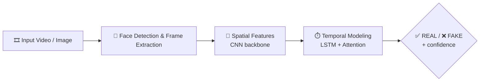

<div align="center">


<a href="https://git.io/typing-svg">
  
</a>

<p>
  
  
  
  
</p>

<p>
  
  
  
</p>

</div>

---

## 📋 Overview

Deepfakes, generated by GANs and diffusion models, are a growing threat to digital forensics and public trust in media. This project is a deep learning-based computer vision system that **detects, analyzes and classifies images and videos as `REAL` or `FAKE`**, with a confidence score.

It began as an academic **Minor Project** and covers the full pipeline: data preprocessing, model training, evaluation, inference, and integration into a web application.

> [!NOTE]
> This work earned a **Letter of Recommendation** for its technical depth and research contribution.

---

## ✨ Highlights

| | |
|---|---|
| 🎯 **Accuracy** | **92% top-1** with XceptionNet, **88%** with the hybrid CNN-LSTM-Attention model (Celeb-DF) |
| 🧠 **Two modeling approaches** | Frame-level spatial analysis and sequence-level temporal analysis |
| 🔁 **End-to-end pipeline** | Frame extraction → face cropping → training → evaluation → inference |
| 🌐 **Deployable** | Models integrated into a scalable web-based application |

---

## 🏗️ How It Works



1. **Preprocessing:** frames are sampled at set intervals from video, faces are detected and cropped to $224 \times 224$ tensors, then normalized.
2. **Spatial feature extraction:** deep CNN backbones pick up pixel-level artifacts, blending boundaries and warping around the face.
3. **Temporal modeling:** LSTM layers with attention track unnatural blinking, irregular motion and frame-to-frame inconsistencies.
4. **Classification:** a binary `REAL` / `FAKE` prediction with a confidence score.

---

## 📈 Results

Evaluated on the **Celeb-DF** dataset:

| Model | Type | Accuracy |
| :--- | :---: | :---: |
| **XceptionNet** | Frame-level CNN | **92%** (top-1) |
| **Hybrid CNN-LSTM-Attention** | Spatio-temporal | **88%** |

<!-- Add precision / recall / F1 / AUC here once you want to show them -->

---

## 🛠️ Tech Stack


`PyTorch` · `OpenCV` · `MTCNN / dlib` · `NumPy` · `Pandas` · `Scikit-Learn` · `Matplotlib`

---

## 📁 Repository Structure

```text
minor_project_deep_fake/
├── data/                  # Dataset folder (raw and processed data)
├── notebooks/             # Jupyter notebooks for analysis & experiments
├── src/
│   ├── preprocess.py      # Video frame extraction & face detection
│   ├── dataset.py         # PyTorch Dataset & DataLoader
│   ├── model.py           # Model architecture definitions
│   ├── train.py           # Training and validation pipeline
│   ├── evaluate.py        # Evaluation & metrics visualization
│   └── infer.py           # Single image / video inference
├── models/                # Saved checkpoints (.pth / .h5)
├── requirements.txt       # Dependencies
└── README.md
```

---

## 🚀 Getting Started

**Prerequisites:** Python `3.8+` · CUDA recommended for GPU acceleration

<details>
<summary><b>📦 Installation</b></summary>

<br>

```bash
# 1. Clone the repository
git clone https://github.com/devyanighildiyal/minor_project_deep_fake.git
cd minor_project_deep_fake

# 2. Create and activate a virtual environment
python3 -m venv venv
source venv/bin/activate        # Linux / macOS
venv\Scripts\activate           # Windows

# 3. Install dependencies
pip install -r requirements.txt
```

</details>

<details>
<summary><b>🗂️ Dataset preparation</b></summary>

<br>

Works with public datasets such as **FaceForensics++**, **DFDC** and **Celeb-DF**. Organize the data like this:

```text
data/processed/
├── train/
│   ├── real/
│   └── fake/
└── val/
    ├── real/
    └── fake/
```

Then extract frames and crop faces:

```bash
python src/preprocess.py --input_dir data/raw --output_dir data/processed
```

</details>

<details>
<summary><b>🏋️ Training</b></summary>

<br>

```bash
python src/train.py --epochs 20 --batch_size 32 --lr 0.001
```

</details>

<details>
<summary><b>📊 Evaluation</b></summary>

<br>

```bash
python src/evaluate.py --model_path models/best_model.pth --test_dir data/processed/val
```

</details>

<details>
<summary><b>🔍 Inference on a single file</b></summary>

<br>

```bash
python src/infer.py --input path/to/sample_video.mp4 --model_path models/best_model.pth
```

</details>

---

## 👥 Team & Acknowledgments

| | |
|---|---|
| **Developers** | [Devyani Ghildiyal](https://github.com/devyanighildiyal) & Kanisha Bansal |
| **Project type** | College Minor Project |
| **Project guide** | Dr. Chandrasen Pandey |

> [!TIP]
> Our sincere gratitude to **Dr. Chandrasen Pandey** for his mentorship, technical direction and continuous guidance throughout this project.

---

## 📜 License

Released under the **MIT License**. See the `LICENSE` file for details.

<div align="center">

⭐ If you found this useful, consider starring the repo!


</div>
